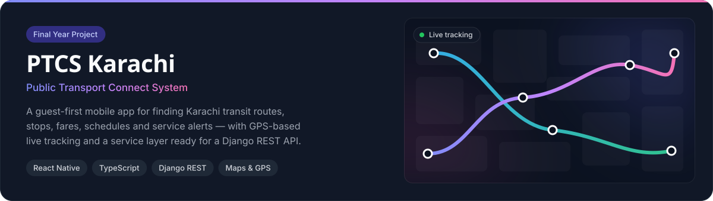
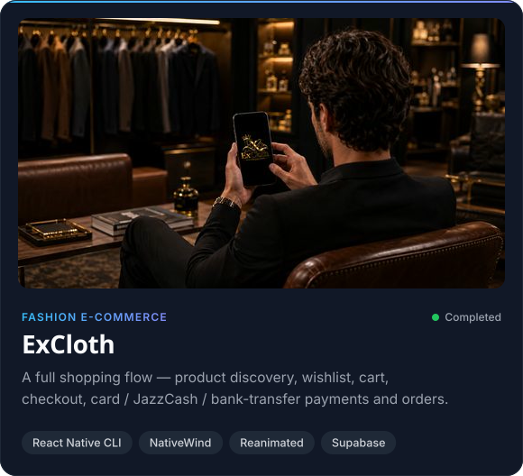
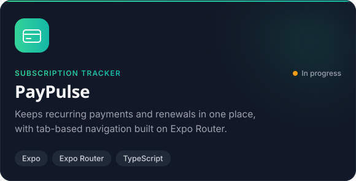
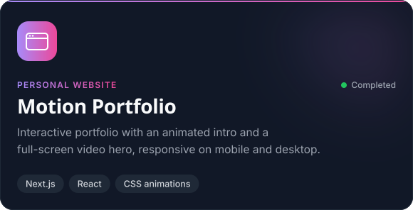

  
  
  
  

## About me

I'm a final-year Computer Science student at Muhammad Ali Jinnah University in Karachi, and I spend most of my time building mobile apps with React Native. I care about the details that make an app feel good to use: smooth navigation, consistent components, and screens that work well on every device.

- 📱 Freelancing as a React Native UI developer since May 2026
- 🚌 Building **PTCS** for my final year project, a public transport app for Karachi
- 🐍 Comfortable on the Python side too: Django, FastAPI and data analysis with Pandas
- 🤝 Open to internships, junior roles and freelance projects

## Tech stack

   
   
  

**For mobile I use:** Expo, Expo Router, React Navigation, NativeWind, Reanimated, Zustand, AsyncStorage and EAS Build. 
**For data work:** Pandas, Matplotlib and Power BI.

## Featured projects

  
  

  
  

<b>Earlier data &amp; Python projects</b>

 

| Project | About | Built with |
|---|---|---|
| [Pharmacy Dashboard](https://github.com/DevSaifullah0/Data-Visualization-Dasboards-PowerBI-) | Sales, cost and profit analysis with a custom data model, DAX measures and slicers | Power BI |
| [Netflix Data Visualization](https://github.com/DevSaifullah0/Netflix_Data_visualization_Matplotlib) | Ratings, durations, yearly trends and top countries in the Netflix catalogue | Pandas, Matplotlib |
| [Customer Data Cleaning](https://github.com/DevSaifullah0/10000Customers_DataCleaninga_Manipulation) | Cleaning and reshaping a 10,000-row customer dataset | Pandas |
| [Saifi AI Assistant](https://github.com/DevSaifullah0/Saifi_Ai_Assistant) | A simple text-based AI assistant | Python |
| [Flask AI Voice Assistant](https://github.com/DevSaifullah0/Flask-Python_Ai_Voice_Assistant) | A voice assistant served through Flask | Python, Flask |

## GitHub activity

  
  

  

<picture>
  <source media="(prefers-color-scheme: dark)" srcset="https://raw.githubusercontent.com/DevSaifullah0/DevSaifullah0/output/github-snake-dark.svg" />
  <source media="(prefers-color-scheme: light)" srcset="https://raw.githubusercontent.com/DevSaifullah0/DevSaifullah0/output/github-snake.svg" />
  
</picture>

## Get in touch

The easiest way to reach me is on [LinkedIn](https://www.linkedin.com/in/saifullah-507754372/) or by [email](mailto:saifullahshaikh634@gmail.com). If you have an internship, a role or a project in mind, I'd be happy to hear about it.

